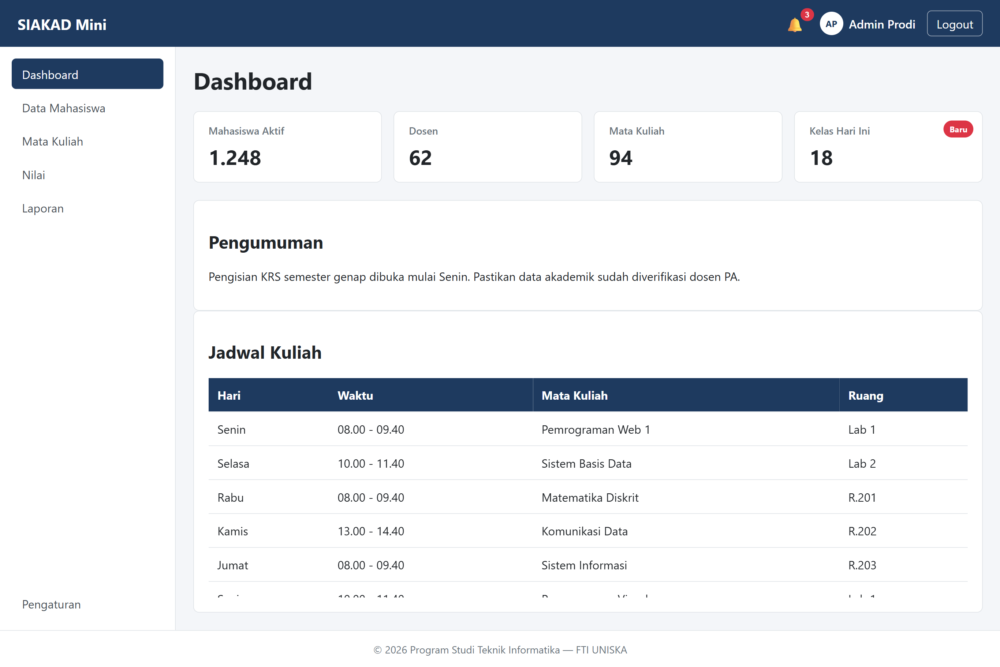
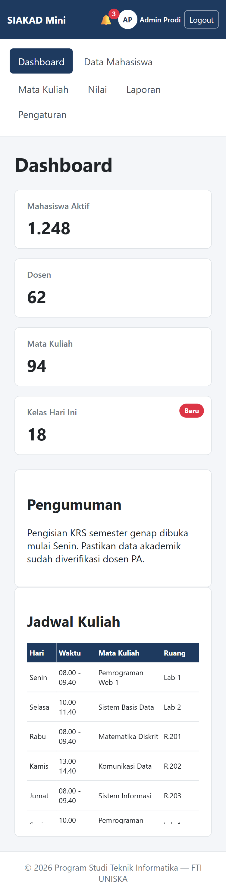

# Laporan Praktikum Pertemuan 5 — Pemrograman Web 1

Nama  : Alfayet Romdoni
NIM   : 2510010275
Kelas : 3B TI REG BJB

## Percobaan 1 — Box Model

### A. Pengukuran Box Model

| No | Kondisi | Lebar Kotak A (px) | Lebar Kotak B (px) |
|---|---|---:|---:|
| 1 | Padding 20px | 350 | 300 |
| 2 | Padding 40px | 390 | 300 |

### B. Margin Collapsing

| No | Kondisi | Jarak Judul–Paragraf (px) |
|---|---|---:|
| 3 | Block biasa | 30 |
| 4 | Di dalam flex column | 50 |

### C. Inline vs Inline-block

| No | Kondisi .menu a | Latar menimpa teks lain? |
|---|---|---|
| 5 | inline (bawaan) | Ya |
| 6 | inline-block | Tidak |

## Percobaan 2 — Flexbox Lab

### Tabel Pengamatan

| No | Properti dan Nilai | Hasil Pengamatan |
|---|---|---|
| 1 | `display: flex` | Item A, B, dan C berubah dari susunan vertikal jadi horizontal. |
| 2 | `justify-content: space-between` | A ada di kiri, C di kanan, dan B di tengah ruang sisa. |
| 2 | `justify-content: space-evenly` | Semua celah termasuk tepi container sama besar. |
| 3 | `align-items: stretch vs center` | Stretch membuat item setinggi container, sedangkan center membuat item setinggi isinya dan berada di tengah vertikal. |
| 4 | `flex-direction: column` + `justify-content: center` | Item tersusun vertikal dan terkumpul di tengah secara vertikal. |
| 5 | 8 item × 200px, nowrap vs wrap | Dengan nowrap, delapan item dipaksa muat dalam satu baris dan menyusut. Dengan wrap, item tetap 200px dan turun ke baris berikutnya. |
| 6 | `.b { flex-grow: 1 }` | Item B mengambil seluruh ruang sisa, sedangkan A dan C tetap selebar isinya. |
| 7 | Lebar A / B / C (px) | A = 200px, B = 266,663px, dan C = 533,337px. |
| 8 | `.c { order: -1 }` | C tampil paling kiri, tapi urutan HTML tetap A, B, C. |
| 9 | `.c { margin-left: auto }` | C terdorong ke ujung kanan, sedangkan A dan B tetap di kiri. |
| 10 | `gap: 24px` | Muncul jarak 24px di antara item tanpa jarak tambahan di tepi container. |

## Percobaan 3 — Positioning

### Tabel Pengamatan

| No | Eksperimen | Pengamatan |
|---|---|---|
| 1 | Header sticky saat digulir | Header tetap menempel di bagian atas halaman ketika halaman digulir, sedangkan konten bergerak. |
| 2a | Header fixed tanpa padding-top body | Header keluar dari aliran normal sehingga judul dan paragraf pertama tertutup oleh header. |
| 2b | Header fixed dengan padding-top 64px | Konten bergeser ke bawah sehingga tidak tertutup oleh header. |
| 3 | `.notif` tanpa `position: relative` | Badge berpindah ke pojok kanan atas header karena titik acuannya berubah ke elemen induk terdekat yang memiliki positioning. |
| 4 | `.lapis-1 z-index: 3`, lalu `.lapis-2 z-index: 5` | Lapis 2 berada di depan Lapis 1 karena memiliki nilai z-index lebih tinggi. |
| 5 | Header z-index 1 | Kotak lapisan dapat menutupi header ketika bertumpuk karena nilai z-index header lebih rendah. |
| 6 | Tombol Bantuan di layar 375px | Tombol Bantuan tetap berada di pojok kanan bawah layar meskipun halaman digulir. |

## Percobaan 4 — Dashboard

## Jawaban Pertanyaan Analisis

Dashboard SIAKAD Mini dibangun menggunakan struktur HTML5 semantik dan CSS Flexbox. Navbar menggunakan position sticky, sidebar memiliki lebar tetap 240px, dan kartu statistik menggunakan Flexbox agar dapat menyesuaikan ukuran layar. Pada tugas mandiri, di bagian navbar ditambah avatar dan identitas Admin Prodi, menu Pengaturan ditempatkan di bagian bawah sidebar, dan label Baru ditambahkan pada kartu Kelas Hari Ini. Tabel jadwal menggunakan area scroll maksimal 300px dengan header sticky supaya judul kolom tetap terlihat saat tabel digulir. Pada layar mobile, layout berubah jadi vertikal menggunakan Media Query.

## Kesimpulan

Dari praktikum ini, saya belajar penerapan Box Model, Flexbox, dan Positioning dalam pengembangan halaman web. Saya juga mulai memahami penggunaan HTML5 semantik, CSS responsif, dan Media Query untuk membangun Dashboard SIAKAD Mini. Kendala yang saya hadapi adalah memahami perhitungan ukuran elemen, pengaturan posisi, serta penyesuaian layout pada ukuran layar yang berbeda. Setelah melakukan pengujian dan perbaikan, dashboard berhasil ditampilkan dengan baik pada layar desktop maupun mobile.

